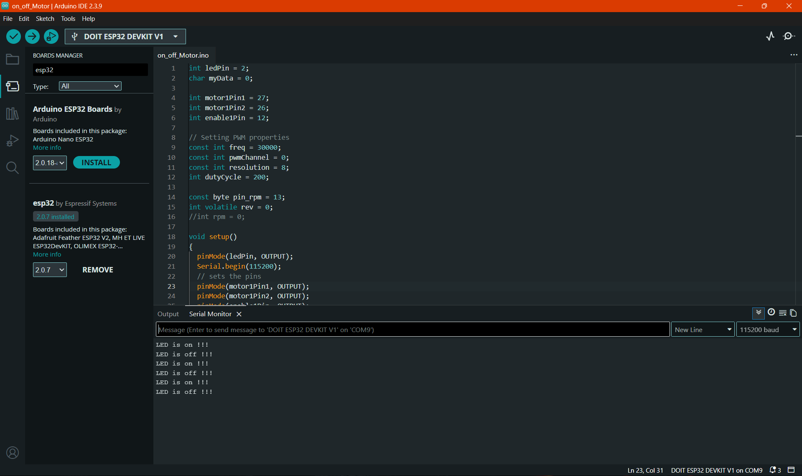
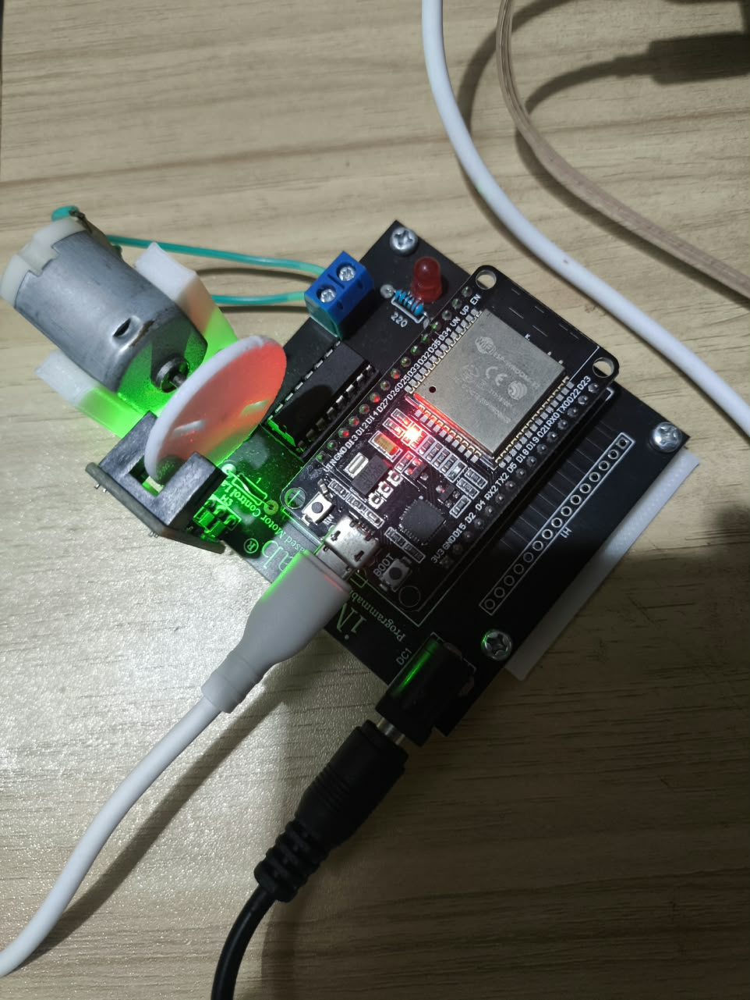
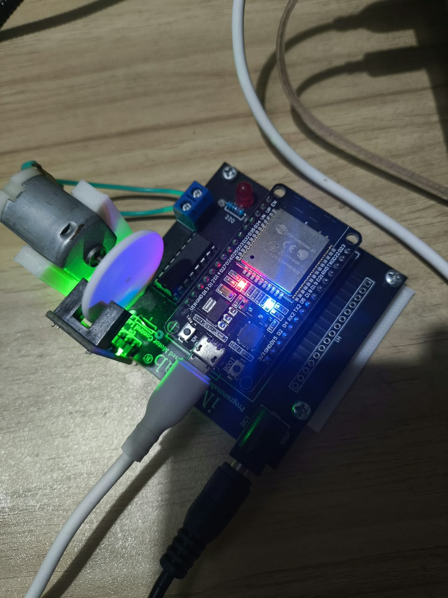

# Laporan Riset Modul 1: Pemrograman Dasar Aktuator Motor DC & PWM pada Kit iMCLab

**Tanggal Eksperimen:** 10 September 2026  
**File Kode Sumber:** `on_off_Motor.ino`  
**Topik:** Pengendalian Dasar Motor DC (ON/OFF) dan Konfigurasi PWM ESP32 Melalui Komunikasi Serial  

---

## 1. Tujuan Eksperimen (Goals)
1. Memahami arsitektur dasar pengendalian aktuator Motor DC pada Kit iMCLab menggunakan mikrokontroler ESP32 dan rangkaian *H-Bridge Motor Driver*.
2. Mengonfigurasi fitur pembangkit sinyal *Pulse Width Modulation* (PWM) internal pada ESP32 (`LEDC` peripheral) untuk mengatur tegangan suplai ke motor.
3. Mengimplementasikan komunikasi serial dasar (*Universal Asynchronous Receiver-Transmitter* / UART) untuk memicu status kerja motor (`ON` dan `OFF`) serta indikator visual (LED) secara *real-time*.

---

## 2. Konfigurasi Pinout & Parameter Perangkat Keras
Berdasarkan skema pada `on_off_Motor.ino`, pemetaan pin GPIO (*General Purpose Input/Output*) pada ESP32 yang terhubung ke Kit iMCLab adalah sebagai berikut:

| Komponen / Fungsi | Pin GPIO ESP32 | Mode Pin | Keterangan Teknis |
| :--- | :---: | :---: | :--- |
| **LED Indikator (`ledPin`)** | GPIO 2 | `OUTPUT` | *Built-in LED* ESP32 sebagai indikator status motor aktif/nonaktif |
| **Input 1 Driver (`motor1Pin1`)** | GPIO 27 | `OUTPUT` | Kontrol arah putaran motor (Logika `HIGH` untuk putar maju) |
| **Input 2 Driver (`motor1Pin2`)** | GPIO 26 | `OUTPUT` | Kontrol arah putaran motor (Logika `LOW` untuk putar maju) |
| **Enable / Kecepatan (`enable1Pin`)** | GPIO 12 | `OUTPUT` (PWM) | Pin penerima sinyal PWM untuk mengatur kecepatan putar motor |
| **Sensor RPM (`pin_rpm`)** | GPIO 13 | `INPUT_PULLUP` | Pin pembacaan *rotary encoder* (disiapkan untuk modul lanjutan) |

**Parameter Konfigurasi PWM (LEDC ESP32):**
* **Frekuensi PWM (`freq`):** `30.000 Hz` (30 kHz) — dipilih di atas batas pendengaran manusia (>20 kHz) untuk menghilangkan bunyi dengung (*coil whine*) pada kumparan motor DC.
* **Channel PWM (`pwmChannel`):** Channel `0`.
* **Resolusi PWM (`resolution`):** `8-bit` (rentang nilai *duty cycle* dari `0` hingga `255`).

---

## 3. Analisis Mendalam Fungsi Kode

### A. Inisialisasi Sistem (`void setup()`)
Pada tahap inisialisasi, komunikasi serial dibuka pada kecepatan **115200 baud** (`Serial.begin(115200)`). Seluruh pin pengendali motor (`motor1Pin1`, `motor1Pin2`, `enable1Pin`) dan `ledPin` diatur sebagai `OUTPUT`.  
Pembangkitan sinyal PWM dikonfigurasi melalui dua fungsi utama ESP32:
1. `ledcSetup(pwmChannel, freq, resolution);` — Mengatur *timer* perangkat keras pada Channel 0 dengan frekuensi 30 kHz dan resolusi 8-bit.
2. `ledcAttachPin(enable1Pin, pwmChannel);` — Menghubungkan keluaran sinyal PWM dari Channel 0 langsung ke pin fisik `GPIO 12` (`enable1Pin`).

### B. Fungsi Penggerak Motor (`MotorOn()` dan `MotorOff()`)
* **`void MotorOn()`:** Mengatur arah putaran motor menjadi satu arah tetap (maju) dengan memberikan logika `HIGH` pada `motor1Pin1` (GPIO 27) dan `LOW` pada `motor1Pin2` (GPIO 26). Kecepatan motor ditentukan dengan menetapkan variabel `dutyCycle = 205` dan menuliskannya ke generator PWM melalui `ledcWrite(pwmChannel, dutyCycle)`. Nilai `205` pada skala 8-bit (`0-255`) merepresentasikan siklus kerja sebesar:
  $$\text{Duty Cycle (\%)} = \frac{205}{255} \times 100\% \approx 80,39\%$$
  Pemberian *duty cycle* sekitar 80% bertujuan agar motor mendapatkan torsi awal yang cukup besar untuk mengatasi inersia diam (*static friction*).
* **`void MotorOff()`:** Mengubah nilai `dutyCycle = 0` dan mengirimkannya melalui `ledcWrite(pwmChannel, 0)`. Meskipun pin arah (`motor1Pin1` dan `motor1Pin2`) tetap berada pada logika `HIGH` dan `LOW`, motor akan berhenti berputar karena pin `enable1Pin` tidak lagi menerima suplai pulsa tegangan (`0%` *duty cycle*).

### C. Logika Pembacaan Perintah Serial (`void loop()`)
Di dalam fungsi `loop()`, mikrokontroler terus membaca *buffer* UART menggunakan `myData = int(Serial.read())`:
* Ketika menerima karakter ASCII `'1'`, ESP32 mengirimkan umpan balik teks `"LED is on !!!"` ke Serial Monitor, menyalakan LED indikator (`digitalWrite(ledPin, HIGH)`), dan mengeksekusi `MotorOn()`.
* Ketika menerima karakter ASCII `'0'`, ESP32 mengirimkan umpan balik teks `"LED is off !!!"`, mematikan LED indikator (`digitalWrite(ledPin, LOW)`), dan mengeksekusi `MotorOff()`.

---

## 4. Hasil Eksperimen & Dokumentasi Output

### A. Log Output Serial Monitor
```text
Testing DC Motor...LED is on !!!
LED is off !!!
```

### B. Dokumentasi Pengujian
*(Masukkan gambar screenshot Serial Monitor dan foto fisik Kit iMCLab Anda di bawah ini)*





---

## 5. Kesimpulan Analisis
1. Pengendalian motor DC pada Kit iMCLab memisahkan antara **kontrol arah putaran** (melalui kombinasi logika digital pada `GPIO 27` dan `GPIO 26`) dan **kontrol kecepatan/daya** (melalui sinyal PWM pada `GPIO 12`).
2. Penggunaan frekuensi PWM sebesar `30 kHz` dengan resolusi `8-bit` terbukti efektif menggerakkan motor DC secara halus pada *duty cycle* `205` (~80,39% daya maksimum) tanpa menimbulkan suara bising frekuensi rendah pada motor.
3. Komunikasi serial pada `on_off_Motor.ino` masih menggunakan metode pembacaan karakter tunggal secara langsung di dalam `loop()`, yang sangat responsif untuk perintah biner sederhana (`'1'` dan `'0'`), serta menjadi fondasi dasar sebelum diintegrasikan dengan skrip otomasi berbasis Python pada modul berikutnya.