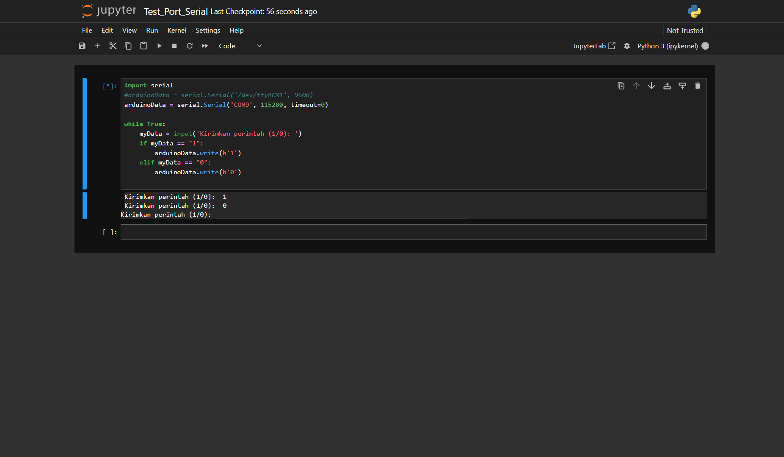
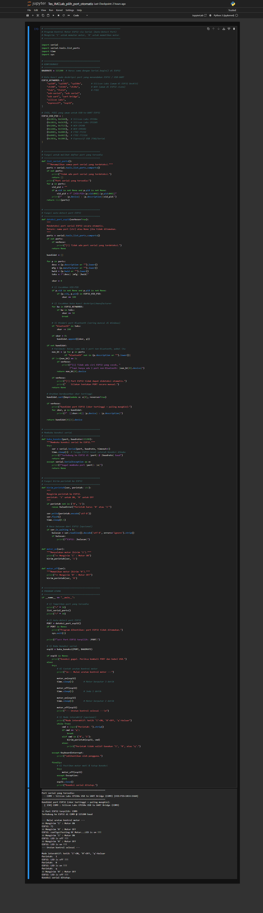

# Laporan Riset Modul 2: Pengendalian Perangkat Keras iMCLab Melalui Python Serial & Algoritma Auto-Detection Port

**Tanggal Eksperimen:** 10 September 2026  
**File Kode Sumber:** `Test_Port_Serial.ipynb`, `Tes_IMCLab_pilih_port_otomatis.ipynb`  
**Topik:** Komunikasi Data Host-Controller (Python) ke ESP32 Menggunakan PySerial dan Implementasi Heuristic Port Scoring  

---

## 1. Tujuan Eksperimen (Goals)
1. Menghubungkan lingkungan runtime Python (Jupyter Notebook) dengan mikrokontroler ESP32 sebagai arsitektur *Host-to-Controller*.
2. Memahami kelemahan penentuan port serial secara statis (*hardcoded*) dan merancang algoritma deteksi port otomatis (*Auto-Detection*) berbasis identifikasi perangkat keras USB-UART.
3. Mengotomasi sekuens pengujian motor DC dan menerapkan penanganan eksepsi (*exception handling*) untuk mencegah penguncian port COM (*port locking*).

---

## 2. Arsitektur Komunikasi & Alur Data
Sistem pada eksperimen ini memanfaatkan komunikasi dua arah berbasis pustaka `pyserial`:
* **Arah Tx (Python ke ESP32):** Mengirimkan data byte karakter (`b'1'` untuk logika ON, `b'0'` untuk logika OFF) melalui jalur USB Virtual COM Port UART dengan baudrate 115200 bps.
* **Arah Rx (ESP32 ke Python):** Python membaca respon string dari ESP32 (`Serial.readline()`) untuk memvalidasi bahwa perintah telah diterima dan dieksekusi oleh driver motor.

---

## 3. Analisis & Komparasi Dua File Implementasi

### A. Analisis `Test_Port_Serial.ipynb` (Implementasi Dasar)
* **Karakteristik Kode:**
  Menginisialisasi serial secara langsung dengan parameter statis `serial.Serial('COM11', 115200, timeout=0)`. Pengiriman instruksi dilakukan di dalam perulangan `while True:`.
* **Kelemahan & Analisis Error:**
  1. *Hardcoded Port:* Kode tidak portabel; apabila Kit iMCLab dihubungkan ke port USB lain atau digunakan di komputer berbeda, program langsung mengalami *crash*.
  2. *Infinite Loop & Unhandled Exit:* Tidak ada mekanisme pemutus perulangan (*break condition*), sehingga penghentian harus dipaksa melalui *Interrupt Kernel* Jupyter yang meninggalkan jejak eksepsi `KeyboardInterrupt: Interrupted by user`.
  3. *Resource Leak:* Jalur serial tidak ditutup dengan method `.close()`, mengakibatkan port COM tetap berstatus sibuk (*busy*) di tingkat sistem operasi Windows.

### B. Analisis `Tes_IMCLab_pilih_port_otomatis.ipynb` (Implementasi Lanjutan)
File kedua mengeliminasi seluruh kelemahan di atas melalui pendekatan modular:
1. **Algoritma Skor Heuristik Port (`deteksi_port_esp32`):**
   Sistem memindai seluruh *comports* aktif dan menghitung bobot probabilitas kecocokan port ESP32:
   * **Kecocokan VID:PID (+100 poin):** Mencocokkan pasangan *Vendor ID* dan *Product ID* chip USB-UART umum seperti CP210x (`10C4:EA60`), CH340 (`1A86:7523`), FT232 (`0403:6001`), dan Native ESP32 JTAG (`303A:1001`).
   * **Kecocokan Kata Kunci (+50 poin):** Menelusuri deskripsi manufaktur seperti `cp210`, `ch340`, `silicon labs`, dan `espressif`.
   * **Filter Port Bluetooth (-200 poin):** Mereduksi interferensi dari perangkat Bluetooth Virtual Serial yang sering terdaftar di OS Windows.
2. **Sekuens Pengujian Terotomasi (*Automated Test Sequence*):**
   Menjalankan siklus kerja terencana (Motor ON 3 detik $\rightarrow$ OFF 1 detik $\rightarrow$ ON 2 detik $\rightarrow$ OFF) tanpa intervensi manual.
3. **Mekanisme Graceful Shutdown:**
   Penggunaan blok `try-except-finally` memastikan bahwa saat pengguna menekan perintah keluar (`'q'`) maupun interupsi keyboard, motor selalu dimatikan (`motor_off(esp32)`) dan saluran koneksi ditutup secara bersih (`esp32.close()`).

---

## 4. Hasil Pengujian & Dokumentasi Output

### A. Log Eksekusi `Test_Port_Serial.ipynb`
```text
Kirimkan perintah (1/0):  1
Kirimkan perintah (1/0):  0
KeyboardInterrupt: Interrupted by user
```

### B. Log Eksekusi `Tes_IMCLab_pilih_port_otomatis.ipynb`
```text
Port serial yang tersedia:
  - COM11 : Silicon Labs CP210x USB to UART Bridge (COM11) [VID:PID=10C4:EA60]
  - COM7 : Standard Serial over Bluetooth link (COM7)
  - COM6 : Standard Serial over Bluetooth link (COM6)
==================================================
Kandidat port ESP32 (skor tertinggi = paling mungkin):
  [ 150] COM11 : Silicon Labs CP210x USB to UART Bridge (COM11)

>> Port ESP32 terpilih: COM11
Terhubung ke ESP32 di COM11 @ 115200 baud

--- Mulai urutan kontrol motor ---
>> Mengirim '1' : Motor ON
ESP32: Testing DC Motor...LED is on !!!
>> Mengirim '0' : Motor OFF
ESP32: LED is off !!!
--- Urutan kontrol selesai ---

Mode interaktif: ketik '1'=ON, '0'=OFF, 'q'=keluar
Perintah: 1 -> ESP32: LED is on !!!
Perintah: 0 -> ESP32: LED is off !!!
Perintah: q -> Koneksi serial ditutup.
```

### C. Tangkapan Layar Output
*(Lampirkan tangkapan layar output sel Jupyter Notebook di bawah ini)*
#### C.1 Output Test_Port_Serial

#### C.2 Output Test_Port_Serial


---

## 5. Kesimpulan Analisis
1. Penggunaan Python sebagai antarmuka pengendali memungkinkan otomasi pengujian aktuator robotika secara terjadwal dan presisi menggunakan parameter waktu (`time.sleep()`).
2. Pemanfaatan identifikasi profil perangkat keras (VID/PID dan deskripsi antarmuka) menghasilkan sistem komunikasi serial yang mandiri (*self-configuring*), sehingga skrip dapat langsung beroperasi tanpa konfigurasi port manual oleh pengguna.
3. Penutupan koneksi secara eksplisit pada blok `finally` merupakan praktik kritis pada pemrograman antarmuka perangkat keras guna mencegah konflik akses COM pada sistem operasi.